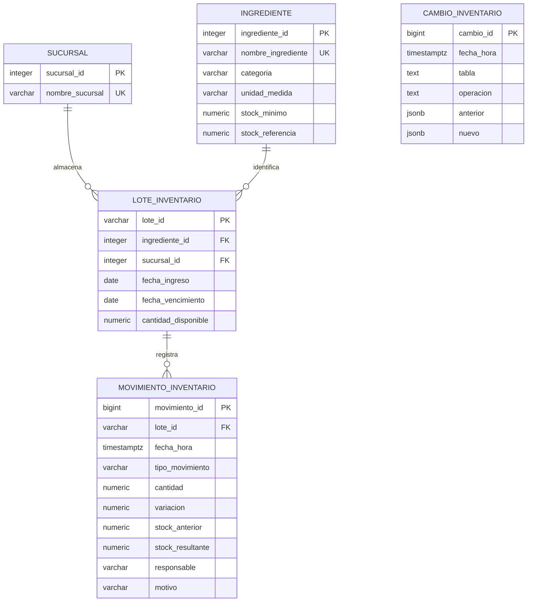

# Modelo de inventario

Todas las entidades se crean en el esquema `inventario`. El respaldo original no se altera.



`cambio_inventario` conserva instantáneas JSON sin llaves foráneas hacia registros auditados, para mantener evidencia de eliminaciones. La unicidad de nombres usa `lower(btrim(nombre_ingrediente))`.

| Entidad | Responsabilidad |
| --- | --- |
| `sucursal` | Sedes precargadas sin administración desde la interfaz. |
| `ingrediente` | Catálogo compartido: categoría, unidad y parámetros de reposición. |
| `lote_inventario` | Existencias de un ingrediente en una sede y con una caducidad determinada. |
| `movimiento_inventario` | Entradas, salidas, mermas y ajustes con motivo y responsable. |
| `cambio_inventario` | Auditoría de inserciones, modificaciones y eliminaciones del módulo. |

## Integridad y transacciones

- PK y FK relacionan ingredientes, lotes, movimientos y sucursales. No hay eliminaciones en cascada.
- Nombres no vacíos y nombres de ingredientes únicos sin distinguir mayúsculas.
- Stocks no negativos, referencia positiva y no menor que el mínimo.
- Código de lote único y vencimiento igual o posterior al ingreso.
- Cantidades `numeric(12,3)`; la API rechaza más de tres decimales.
- Un insumo con lotes conserva su unidad y no se elimina, incluso si sus lotes están vacíos.
- La API no permite editar ni eliminar movimientos, ni reemplazar directamente el saldo.
- Una recepción inserta el lote con saldo cero y su movimiento de entrada en la misma transacción.
- El trigger `movimiento_aplica_stock` bloquea el lote con `SELECT ... FOR UPDATE`, calcula la variación, valida vigencia y actualiza el saldo. La falta de saldo revierte toda la transacción.
- Un ajuste compara el conteo físico con el saldo. Rechaza el conteo idéntico porque no genera cambio.
- La auditoría se registra en la misma transacción. Las operaciones rechazadas no dejan movimientos ni auditorías parciales.

Las consultas usan parámetros SQL. Las validaciones se aplican en servidor y navegador; los valores se escapan antes de mostrarlos.

## Vista, CTE e índices

`inventario.existencias` utiliza la CTE `saldos` para agregar existencias por ingrediente y sucursal. Un `CROSS JOIN` incluye insumos sin lotes, con saldo cero. Devuelve stock utilizable, stock vencido, lotes próximos a vencer, siguiente vencimiento y umbral de alerta. No se suman unidades distintas en un único indicador.

Hay índices sobre nombre de ingrediente, relación sucursal/ingrediente, vencimiento de lotes con saldo y fecha de movimientos. El módulo utiliza DDL, DML, restricciones, vistas, CTE, índices y triggers.

## API

| Método | Ruta | Operación |
| --- | --- | --- |
| GET | `/api/health` | Verifica PostgreSQL. |
| GET | `/api/inventario?sucursal_id=1` | Catálogo, existencias, lotes y movimientos de la sede. |
| POST | `/api/insumos` | Crea un ingrediente compartido. |
| PUT | `/api/insumos/<id>` | Edita nombre, categoría y parámetros. |
| DELETE | `/api/insumos/<id>` | Elimina un insumo sin lotes en ninguna sede. |
| POST | `/api/lotes` | Recibe lote y registra entrada atómica. |
| POST | `/api/movimientos` | Registra movimiento y actualiza saldo mediante trigger. |

La lectura usa una transacción `REPEATABLE READ` de solo lectura: las tablas de una respuesta corresponden a la misma instantánea. Los decimales se serializan como cadenas para preservar precisión. Las fechas son ISO y los movimientos incluyen zona horaria. Se devuelve el historial completo de la sucursal; la búsqueda y paginación se hacen en la interfaz. Para mayores volúmenes se puede trasladar la paginación al servidor.

Ejemplo de ingrediente:

```json
{
  "nombre_ingrediente": "Café de especialidad",
  "categoria": "Café y té",
  "unidad_medida": "kg",
  "stock_minimo": "3.000",
  "stock_referencia": "20.000"
}
```

Ejemplo de recepción (usar una fecha vigente):

```json
{
  "lote_id": "CAFE-2026-01",
  "ingrediente_id": 1,
  "sucursal_id": 1,
  "fecha_vencimiento": "2026-12-15",
  "cantidad": "5.500",
  "responsable": "Encargado de inventario",
  "motivo": "Compra a proveedor, factura 1042"
}
```

Ejemplo de salida:

```json
{
  "lote_id": "CAFE-2026-01",
  "tipo_movimiento": "Salida",
  "cantidad": "0.250",
  "responsable": "Encargado de inventario",
  "motivo": "Consumo en barra"
}
```

Errores: 400 para validación, 404 para registros inexistentes en edición/eliminación, 409 para conflictos por duplicidad/saldo/trazabilidad y 503 si PostgreSQL no está disponible.

## Integración posterior

La separación por esquema permite evaluar inventario sin implementar otros casos de uso. Para integrarlo con el sistema completo se deben mapear los identificadores, migrar datos, reemplazar responsable de texto por la identidad de usuario/empleado y reutilizar el control de acceso del equipo. Las diferencias con el respaldo se describen en el README. No se ejecuta restauración ni migración automática sobre la base compartida.
